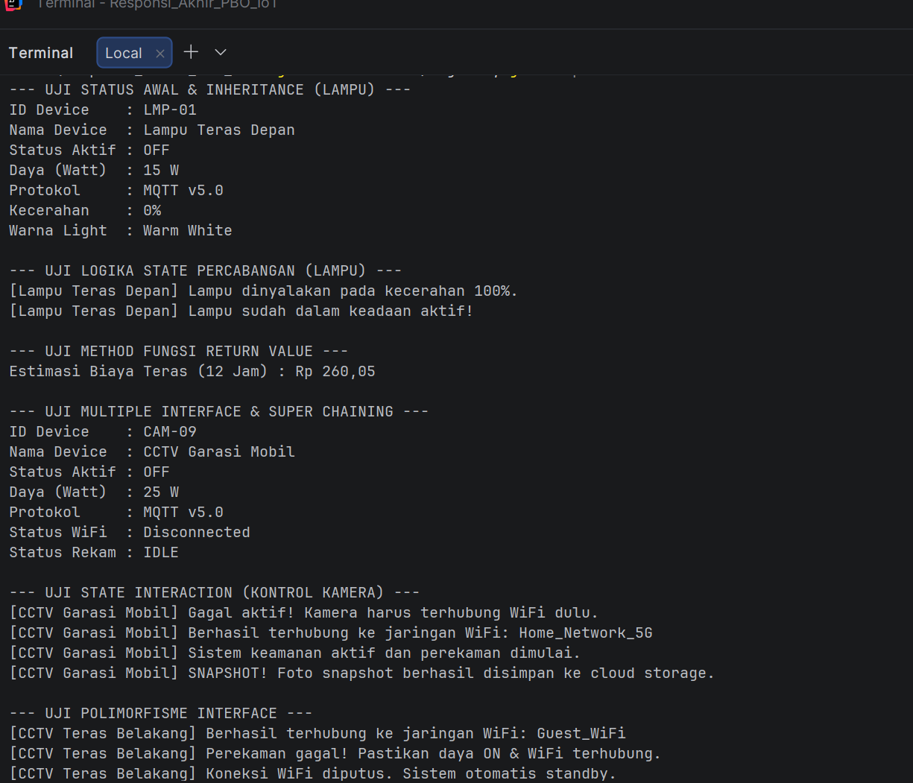

### Nama : Fadillah Mauladi Yofiawan
### Tema Responsi : IoT
### NIM : H1D025015

 Petunjuk Compile dan Run (Terminal IntelliJ IDEA)
Proyek ini diproses dan dijalankan menggunakan Terminal bawaan IntelliJ IDEA dengan langkah-langkah berikut:
# 1. Membuka Terminal IntelliJ IDEA
- Buka proyek di IntelliJ IDEA.
- Buka panel terminal di bagian bawah layar melalui menu **View > Tool Windows > Terminal** (atau tekan `Alt + F12`).
# 2. Kompilasi dan Eksekusi Program
1. **Compile seluruh file Java ke folder out:**
   ```bash 
   javac -d out src/*.java && java -cp out Main

## Screenshot Luaran Program

